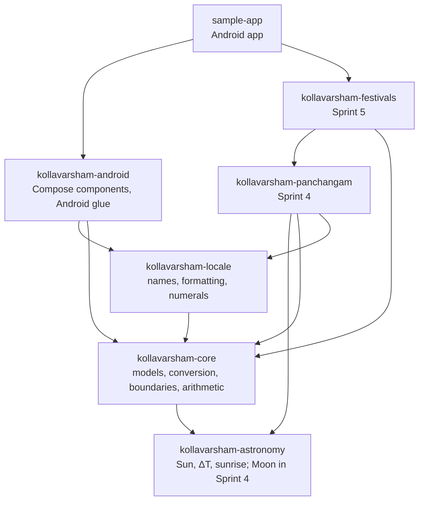

# Architecture

Status: **Proposed (Sprint 0)**

## 1. Principles

1. **Accuracy first:**
   - Every calendar rule traces to a source in `CALENDAR_ALGORITHM.md`.
   - Every month boundary is explainable: its sankranti instant, its cut-off, its margin, and whether it came from computation or an override.
2. **Pure, deterministic core:**
   - No Android, I/O, network, clocks or global mutable state.
   - "Today" is always passed in, or comes from an injected `java.time.Clock`.
3. **Minimal dependencies:** the core modules depend only on the Kotlin stdlib.
4. **Few interfaces:** an interface exists only where a second implementation is real, for example an override source or an observance provider in Sprint 5.
5. **SDK ≠ app:** the consumer calendar app is a separate product that consumes the published artifacts.

## 2. Modules



| Module | Type | Depends on | Responsibility | Introduced |
|---|---|---|---|---|
| `kollavarsham-astronomy` | Kotlin/JVM | stdlib | Apparent solar longitude, nutation, ΔT, Lahiri ayanamsa, sankranti search, sunrise and sunset. Moon in Sprint 4. | Sprint 1 (skeleton), Sprint 2 (implemented) |
| `kollavarsham-core` | Kotlin/JVM | astronomy | Domain models, `KollavarshamCalendar`, month boundaries, conversion, validation, date arithmetic, override mechanism | Sprint 1 |
| `kollavarsham-locale` | Kotlin/JVM | core | Malayalam and English names, transliteration, Malayalam numerals, `format()` APIs | Sprint 1 (names), Sprint 3 (formatting) |
| `kollavarsham-panchangam` | Kotlin/JVM | core, locale, astronomy | Nakshatra, tithi, sunrise and sunset providers, location configuration; names of its own types | Sprint 4 |
| `kollavarsham-festivals` | Kotlin/JVM | core, panchangam | Festival definitions as **rules**, never as dates; observance providers | Sprint 5 |
| `kollavarsham-android` | Android library | core, locale | Optional Compose month grid and date picker. No business logic in Composables. | Sprint 6 |
| `sample-app` | Android app | all | Demo only; not published | Sprint 6 |

### Changes from the brief, with reasons

1. **New `kollavarsham-astronomy` module.**
   - Month boundaries require the sankranti and sunrise, so astronomy is not just a panchangam concern.
   - Putting it in core would force the panchangam module either to depend on core internals or to duplicate the maths.
   - Its public API is marked with an opt-in annotation, `@KollavarshamAstronomyApi`, so it can evolve without SemVer promises until Sprint 7.
2. **`kollavarsham-data` renamed to `kollavarsham-locale`.** The module holds names, transliteration and numerals. "Data" suggests a persistence layer, such as Room.
   - [OPEN Q6] Do you agree with the rename?
3. **No `GregorianDate` model.**
   - The public API uses `java.time.LocalDate`. It is available natively from Android API 26, and below that through core-library desugaring.
   - A custom Gregorian type would duplicate a well-tested standard type. See ADR-0004.

## 3. Package layout (core)

```
io.github.anjalymsajeev.kollavarsham.core            // public API: KollavarshamCalendar, MalayalamDate, MalayalamMonth, …
io.github.anjalymsajeev.kollavarsham.core.boundary   // internal: month-start computation, cache, overrides
```

Group ID `io.github.anjalymsajeev`, package root `io.github.anjalymsajeev.kollavarsham` (Q4, default chosen at the start of Sprint 1). Validation types live in the root package.

- **[Q4, resolved]** We avoided `org.kollavarsham.*`, which the existing kollavarsham.org project already uses on Maven Central.
- The suggestion is a namespace you control (e.g. `io.github.<user>.kollavarsham` or your own domain).

## 4. Cross-cutting concerns

- **Thread safety:**
  - All public types are immutable.
  - The month-boundary cache is a `ConcurrentHashMap<Int, YearBoundaries>` with idempotent computation. Two threads may compute the same year, and the results are identical.
- **Errors:** Error handling follows the Kotlin stdlib idiom.
  - Throwing functions raise typed exceptions.
  - `...OrNull` variants return null instead.
  - `validate()` returns a sealed `DateValidation`.
  - Incorrect dates are never returned silently.
- **API stability:**
  - The Kotlin **binary-compatibility-validator** plugin will be enabled in Sprint 1 to track the public API from the start.
  - Releases follow SemVer from 1.0.0. Releases numbered 0.x may break.
- **Build:**
  - Gradle Kotlin DSL with a version catalog and `explicitApi()` in library modules.
  - JVM target 11 for Android compatibility.
  - ktlint or detekt for style checks.
  - JUnit 5 and kotlin-test.
  - [OPEN Q7] Kotest property testing (test-only dependency) or hand-rolled property loops?
- **Kotlin Multiplatform:**
  - Not in scope. The core is written so that a later KMP move is cheap: `java.time` is used only at the API edge, and calculations work on epoch days.
  - [OPEN Q8] Is iOS a future target? If yes, an ADR is needed before Sprint 3.

## 5. Decision records

See `docs/adr/`.
